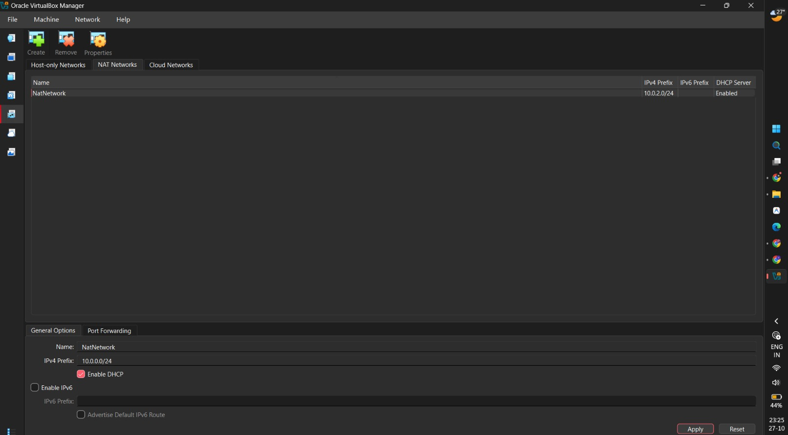
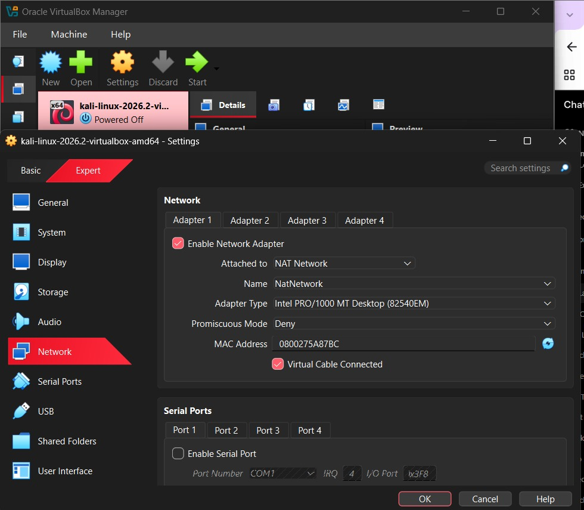
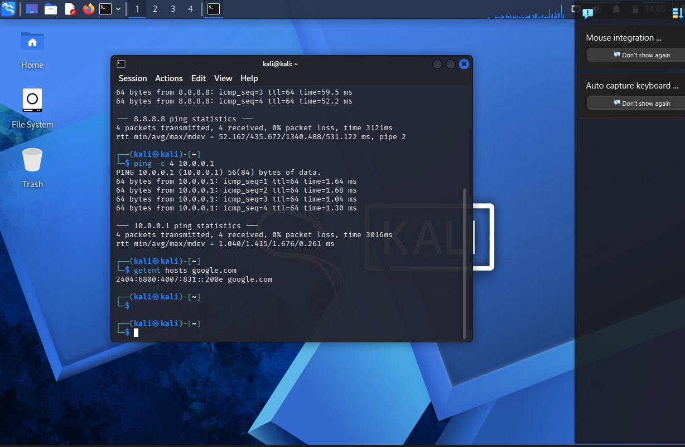

# Week 1 – Cybersecurity Lab Setup

## Overview
This project documents my Week 1 internship task of setting up a cybersecurity lab using Kali Linux and Oracle VirtualBox.

The goal was to configure the virtual machine, establish network connectivity, and prepare the environment for future cybersecurity practice.

## Tools Used
- Kali Linux 2026.2
- Oracle VirtualBox
- NAT Network

## Network Configuration
- Network Name: `NatNetwork`
- Network Subnet: `10.0.0.0/24`
- Default Gateway: `10.0.0.1`
- Kali IP: `10.0.0.2/24`

## Tasks Completed
- Configured the VirtualBox NAT Network.
- Configured Kali Linux networking.
- Tested internet connectivity and DNS resolution.
- Enabled clipboard and drag-and-drop.
- Configured a shared folder.
- Created a VM snapshot.

## Screenshots

### 1. Network Connectivity

### 2. VirtualBox Network Adapter

### 3. NAT Network Configuration

## Key Learnings
This task helped me understand virtual networking, Linux network troubleshooting, and the importance of maintaining a reliable lab environment for cybersecurity practice.

## Purpose
This lab is intended for learning and authorized cybersecurity testing.

**Status:** Week 1 lab setup completed.
